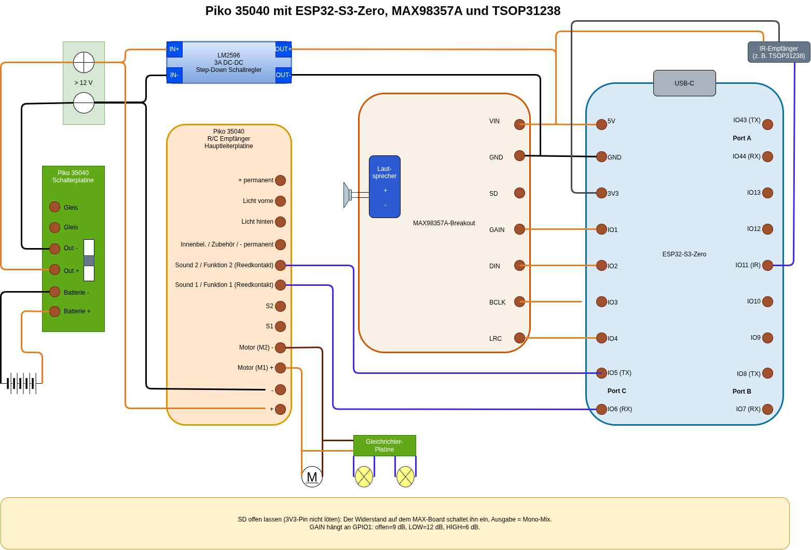
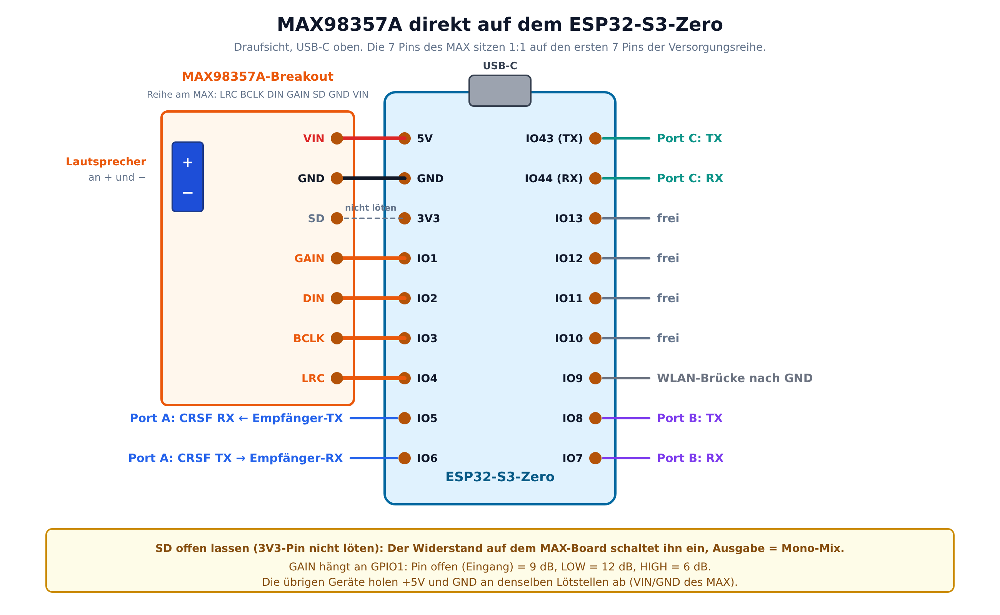
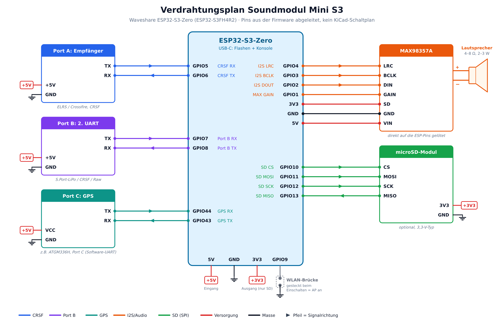
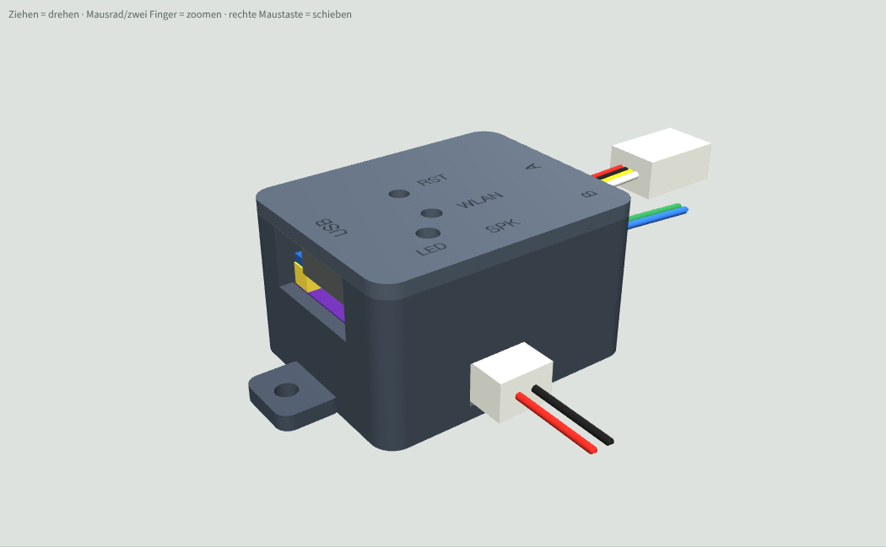

# Soundmodul Mini (S3 und C3)

## Eigene Ergänzungen für Piko 35040

Kompaktes Eisenbahn-Soundmodul aus Mikrocontroller ESP32-S3-Zero (ESP32-S3FH4R2) und Verstärker MAX98357A,
steuerbar via Reed-Trigger vom R/C Empfänger Piko 35040, und abgeleitet von https://github.com/mnorden81/ESP32-Sound-Mini-S3.

**Aktuelle Fork-Version:** v0.13+dl7mo.8 (Basis upstream v0.13, RC_Common 1.4.0 upstream-identisch; Reed-Rolle projektlokal `APP_UROLE_REED` = 100; Reed-Trigger pro Port A/B/C mit frei wählbaren Pin-Aktionen und GPIO-Anzeige im Web-Tab; leere Sound-Plätze blockieren Motorsound und One-Shots nicht mehr; LED-Farbfolge auch im Web-Tab „Reed“ einstellbar; Status-LED dunkel im Reed-Modus ohne Flamme; S3 zuletzt auf Hardware getestet: v0.13+dl7mo.8 am 18.11.2026; C3-Variante weiterhin nicht auf Hardware getestet). Details: [docs/fork-changelog.md](docs/fork-changelog.md).

**Ablauf-Übersicht:** [docs/audio-ablauf.md](docs/audio-ablauf.md) – wie Trigger, Motorsound und die Zusatzsounds im Code zusammenwirken.

### Reed-Betrieb (Piko 35040)



Seit `v0.13+dl7mo.1` (früher v0.14) ist Reed keine feste Compile-Option mehr, sondern eine **Port-Rolle**: Unter „Einstellung“ kann Port A (und auf dem S3 auch B/C) auf `Aus`, `CRSF` oder `Reed` gestellt werden. Im Reed-Modus werden **beide Pins des Ports als Eingänge mit Pull-up** gelesen (kein UART); ein Kontakt gegen GND löst einen Impuls aus. Rollenwechsel wirken erst nach einem Neustart.

Im Web-Tab **„Reed“** wird pro Pin (RX/TX) eines Reed-Ports die Aktion gewählt und einzeln getestet; daneben steht die GPIO-Nummer (z. B. `RX (IO5)` auf Port A des S3):

| Aktion | Wirkung |
|---|---|
| Keine | kein Trigger |
| Sound 1–4 | spielt den entsprechenden Sound-Slot (One-Shot, wie ein Web-Test) |
| Motor Ein/Aus | schaltet den Motorsound ein/aus (Toggle) |
| Flamme Ein/Aus | schaltet den Flammeneffekt der Status-LED ein/aus (Toggle) |

Ein Reed-Impuls legt die Aktion in dieselbe kleine Kommando-Queue wie die Web-Testbuttons; ausgeführt wird sie zentral in `loop()`. Die Entprellzeit (5–500 ms, Default 50 ms) und alle Aktionen werden sofort übernommen und in der Konfiguration gespeichert (auch in Export/Backup).

Lange Tastendrücke werden nicht ausgewertet, weil sie sich mit dem Piko 35040 nicht zuverlässig unterscheiden lassen. Wird Port A auf Reed/Aus gestellt, gibt es kein CRSF-Signal mehr: Der Auto-WLAN-Failsafe schaltet dann nach der eingestellten Zeit das WLAN ein, und der Motorsound läuft ohne Gaskanal mit der Mindestdrehzahl. Die Flamme überlagert in diesem Fall die Status-LED.

### Versionen dieses Forks

Chronologische Liste: [docs/fork-changelog.md](docs/fork-changelog.md). Die Upstream-Historie bleibt unverändert in [CHANGELOG.md](CHANGELOG.md).

---

*Ab hier folgt die unveränderte README des Upstream-Projekts.*
# Soundmodul Mini (S3 und C3)

Kompaktes Soundmodul für Motorgeräusche und Effekte auf Basis ESP32-S3-Zero (ESP32-S3FH4R2, 4 MB Flash, 2 MB PSRAM). Seit v0.09 läuft derselbe Code auch auf dem **ESP32-C3 Pro Mini** (4 MB Flash, kein PSRAM), siehe [ESP32-C3 Pro Mini](#esp32-c3-pro-mini).
Abgeleitet von [ESP32-RC-Sound V7](https://github.com/mnorden81/mnorden81-ESP32-Sound-bidirectional_code), reduziert auf:

- **Eingang:** nur CRSF (Port A), busbasiert
- **Sounds:** Motor (Start/Loop/Stopp) + 4 Zusatzsounds
- **Speicher:** Flash (LittleFS), keine SD-Karte
- **Klangqualität (ab v0.15):** Mischer repariert. Ein Kanal wurde bei jedem negativen Sample zerstört, der eingebaute „Kompressor“ hat alles über ca. −9 dB verzerrt (jetzt ein sauberer Begrenzer, der nur bei Übersteuerung eingreift), Volumen über 100 % kippt nicht mehr über, andere Abtastraten und die Motor-Drehzahl werden weich umgerechnet (lineare Interpolation, kein Phasensprung an der Puffergrenze), 8-Bit-WAV wird richtig gelesen. Nicht auf Hardware getestet.
- **Funk (ab v0.14):** CRSF per ESP-NOW statt Kabel, wie Multiswitch v5.04 und CRSF-Router S3. Lua-Ordner „Funk“ oder Web-UI (Einstellung → Funk): Betrieb Kabel / Kabel + Funk (Zentrale) / Funk (Teilnehmer), Fahrzeug-Kennung, Funkkanal, Sendeleistung, Kanal-Rate (Zentrale), Rückkanal (Teilnehmer). Gilt nach Neustart. Mit Funk läuft das WLAN auf dem Funkkanal, der Web-Tab „Funk“ zeigt Verbindung, Verlust und Gegenstellen.
- **Lua-Ordner „Sounds“ (ab v0.14):** oben „Sound Nr“ wählen, darunter stehen sofort Name, Quelle, Kanal, Volumen, Wiedergabe und Test dieses Sounds. Gleich in allen Soundmodulen.
- **Ports:** Port A (CRSF), Port B und Port C als Hardware-UART, Rolle je Port in Web-UI und Lua wählbar: Aus, CRSF (Modulkette), S.Port, GPS oder Raw
- **Status-LED:** RGB-LED des S3-Zero (GPIO 21) zeigt den CRSF-Link, gleiches Farbschema wie alle Module (siehe [Status-LED](#status-led))
- **Web-UI:** Sound-Upload und OTA-Update per WLAN, WLAN ab Werk immer an, sonst per BOOT-Taste oder Lua einschaltbar
- **Verstärker:** MAX98357A (I2S)

**Aktuelle Version:** v0.13 (noch nicht auf Hardware getestet, zuletzt getestet: v0.07 am 29.10.2026; C3-Variante noch nicht getestet). Alle Versionen: [CHANGELOG.md](CHANGELOG.md).

Die Firmware ist eine Arduino-Skizze: `firmware/ESP32_Sound_Mini_S3/ESP32_Sound_Mini_S3.ino`. Gemeinsamer Code mit Multiswitch und Soundmodul V7 liegt in `firmware/ESP32_Sound_Mini_S3/src/RC_Common/` (identische Kopie, siehe README dort). Gebaut wird mit dem Arduino-ESP32-Core 3.0.7 (Arduino IDE oder PlatformIO).

Projektbeschreibung: [`docs/Projektbeschreibung.docx`](docs/Projektbeschreibung.docx) · Ursprünglicher Projektplan (Archiv): [`docs/projektplan.md`](docs/projektplan.md)

## Projektvideo

[](https://github.com/mnorden81/RC-CRSF-Router-ESP32-S3/blob/main/docs/video/CRSF-Oekosystem_Projektvorstellung.mp4)

Rund zwei Minuten Überblick über das ganze CRSF-Ökosystem: CRSF-Router, Multiswitch, Soundmodule, der ESP-NOW-CRSF-Link mit Funk in den Modulen und die Prüfstände für WebUI und Lua-Menü. Bild anklicken, dann startet das Video auf GitHub. Das Video liegt im Repo [RC-CRSF-Router-ESP32-S3](https://github.com/mnorden81/RC-CRSF-Router-ESP32-S3/tree/main/docs/video), weil es alle Module gemeinsam zeigt.

## Flash-Aufteilung (4 MB)

2 × 1,25 MB Firmware (OTA) + ca. 1,3 MB Sounds (≈ 30 s bei 22,05 kHz, 16 Bit mono).

## Speicherbelegung anzeigen

Seit v0.06 zeigt das Modul, wie voll Flash und RAM sind:

- **Weboberfläche:** Tab „Debug“, Karte „Speicherbelegung“ (aktualisiert sich alle 2 s). Balken für Firmware, Sounds (Flash), RAM und PSRAM, ab 90 % gelb, ab 98 % rot. Prozent und Balken zeigen immer den belegten Anteil. Seit v0.07 listet die Karte „Dateien im Flash“ alle Dateien mit Größe (Sounds, Backups, evtl. Reste), und „WAV Dateien“ zeigt, ob jede Sound-Datei im Flash liegt.
- **Lua-Menü am Sender:** Ordner „Speicher“ (nur Anzeige): Firmware, Sounds, RAM frei, PSRAM frei. Die Werte werden beim Öffnen des Ordners neu gelesen.

| Anzeige | Bedeutung |
|---|---|
| Firmware | Größe der Firmware im Verhältnis zur App-Partition (1,25 MB). Die Firmware muss in eine Partition passen, sonst ist kein OTA-Update möglich. |
| Sounds | Belegter Platz im Flash-Dateisystem (Sounds und Einstellungs-Backups), ca. 1,3 MB. Seit v0.08 aus den Dateien berechnet (auf 4-KB-Blöcke aufgerundet plus Verwaltung). |
| RAM | Belegter und freier interner Arbeitsspeicher, „min frei“ = kleinster freier Wert seit dem Start |
| PSRAM | Freier externer RAM (2 MB beim S3FH4R2) |

In der Arduino IDE steht nach „Überprüfen“ zusätzlich die Firmware-Größe im Ausgabefenster („Der Sketch verwendet … Bytes“).

## Sounds

Format: WAV, 16 Bit PCM, 22,05 kHz mono empfohlen.

**Seit v0.12 behalten Sounds ihren Namen.** Beim Hochladen werden nur Umlaute ersetzt (ä → ae), Leerzeichen werden zu `_`, und der Name wird auf 26 Zeichen plus `.wav` gekürzt. Welcher Sound auf welchem Platz spielt (Loop, Standgas, Start, Sound 1–4), legst du so fest:

- **Web-UI, Tab „Speicher“:** zeigt alle gespeicherten Sounds mit Größe und Platz. Pro Platz gibt es eine Auswahlliste. Ein Sound darf auf mehreren Plätzen liegen. Dort kannst du auch Sounds hochladen (mehrere auf einmal) und löschen.
- **Web-UI, Tabs „Motor“ und „Sounds“:** „Hochladen“ speichert die Datei mit ihrem Namen und legt sie gleich auf diesen Platz.
- **Lua-Menü, Ordner „Sound-Zuordnung“**: erst „Platz“ wählen, dann bei „Datei“ den Sound. Namen sind dort auf 12 Zeichen gekürzt, die Liste zeigt bis zu 20 Dateien. Neu hochgeladene Sounds erscheinen nach erneutem Öffnen des Menüs.

Module mit älterer Firmware behalten ihre Sounds: `loop.wav`, `shut.wav`, `start.wav` und `sound1.wav` … `sound4.wav` bleiben auf ihren Plätzen. Die Zuordnung steht im Export und im Backup.

Die Sounds liegen im Flash (LittleFS). Das Mini hat keine SD-Karte, die Auswahl Auto/Flash/SD gibt es seit v0.04 nicht mehr.

Sounds ins Flash bringen:

1. Web-UI: Tab „Speicher“, „Motor“ oder „Sounds“ → WAV hochladen
2. USB: Dateien nach `firmware/data/` legen, dann `pio run -t uploadfs` (danach im Tab „Speicher“ zuordnen, außer die Dateien heißen `loop.wav` … `sound4.wav`)

Konfigurations-Backups liegen ab v0.04 im Flash (Weboberfläche, Karte „Konfiguration sichern“: im Modul sichern, wiederherstellen, löschen; automatisch vor jedem Import und Firmware-Update). `pio run -t uploadfs` überschreibt den ganzen Flash-Speicher und damit auch diese Backups.

## Firmware flashen

Es gibt drei Wege. Ein neues Modul wird einmal per USB geflasht (Weg 1 oder Weg 2), danach geht jedes Update bequem per WLAN (Weg 3).

| Weg | Braucht | Einstellungen im Modul |
|---|---|---|
| 1. Fertige Datei aus GitHub + Web-Flasher | nur Chrome oder Edge | werden **gelöscht** |
| 2. Arduino IDE | Arduino IDE 2.x | bleiben erhalten |
| 3. Update per WLAN | Handy oder PC mit WLAN | bleiben erhalten |

Derselbe Sketch läuft auf dem ESP32-S3-Zero und dem ESP32-C3 Pro Mini, `pins.h` wählt die Pins nach dem Board. Unterschiede stehen jeweils dabei.

### Weg 1: Fertige Firmware aus GitHub (ohne Arduino IDE)

GitHub baut die Firmware bei jeder Änderung automatisch (Workflow „CI“).

1. Auf GitHub angemeldet sein (sonst gibt es keinen Download-Knopf).
2. In diesem Repo oben auf **Actions** klicken, links den Workflow **CI** wählen.
3. Den obersten Lauf mit grünem Haken öffnen (Branch `main`).
4. Ganz unten unter **Artifacts** **sound-mini-s3-firmware** (ESP32-S3-Zero) bzw. **sound-mini-c3-firmware** (ESP32-C3 Pro Mini) herunterladen und die ZIP-Datei entpacken. Darin liegen u. a. `ESP32_Sound_Mini_S3.ino.merged.bin` (Komplett-Image für USB) und `ESP32_Sound_Mini_S3.ino.bin` (nur für Weg 3).
   Steht dort nichts (Artefakte werden nach 90 Tagen gelöscht): rechts oben **Run workflow** → **Run workflow** klicken, nach ca. 3 Minuten ist ein neuer Lauf fertig.
5. Modul mit einem USB-C-**Datenkabel** an den PC stecken (kein reines Ladekabel). Ein Treiber ist unter Windows 10/11 nicht nötig. Die BOOT-Taste dabei **nicht** drücken.
6. In **Chrome** oder **Edge** die Seite https://espressif.github.io/esptool-js/ öffnen (Espressif-Web-Flasher, Firefox geht nicht).
7. **Connect** klicken und den COM-Port des Moduls wählen. Klappt das nicht: Baudrate oben auf `115200` stellen und das Modul mit der BOOT-Taste in den Flash-Modus bringen (siehe Weg 2, „Wenn das Hochladen nicht klappt“).
8. Unter **Flash Address** `0x0` eintragen, mit **Datei auswählen** die `.merged.bin` wählen, dann **Program** klicken.
9. Wenn unten „Leaving…“ steht, das USB-Kabel kurz abziehen und wieder einstecken. Fertig.

> **Achtung:** Das Komplett-Image überschreibt den ganzen Flash (4 MB). Alle Einstellungen, Backups und **alle Sounds im Flash** sind danach weg. Vorher in der Weboberfläche die Einstellungen als Datei sichern (Karte **Konfiguration sichern / wiederherstellen** → „Export“; die WAV-Dateien am PC aufheben und danach wieder hochladen) und hinterher dort wieder importieren. Wer die Einstellungen behalten will, nimmt Weg 2 oder 3.

### Weg 2: Arduino IDE

**Einmalig einrichten**

1. Arduino IDE 2.x installieren (https://www.arduino.cc/en/software).
2. **Datei → Einstellungen → Zusätzliche Boardverwalter-URLs**: `https://espressif.github.io/arduino-esp32/package_esp32_index.json` eintragen.
3. **Werkzeuge → Board → Boardverwalter**: „esp32“ suchen, **esp32 von Espressif Systems** in Version **3.0.7** installieren.
4. **Werkzeuge → Bibliotheken verwalten**: **TinyGPSPlus 1.0.3** suchen und in genau dieser Version installieren.
   Alles andere (z. B. `src/RC_Common/`) liegt schon im Sketch-Ordner.

**Flashen**

1. Repo herunterladen: oben auf GitHub **Code → Download ZIP**, entpacken (oder den vorhandenen Ordner nehmen).
2. In der Arduino IDE **Datei → Öffnen** und `firmware/ESP32_Sound_Mini_S3/ESP32_Sound_Mini_S3.ino` wählen.
3. Unter **Werkzeuge** einstellen:

   | Einstellung | Wert |
   |---|---|
   | Board | **ESP32S3 Dev Module** (S3-Zero) bzw. **ESP32C3 Dev Module** (C3 Pro Mini) |
   | USB CDC On Boot | **Enabled** |
   | USB Mode (nur S3) | Hardware CDC and JTAG |
   | Flash Size | **4MB (32Mb)** |
   | Partition Scheme | **Default 4MB with spiffs (1.2MB APP/1.5MB SPIFFS)** |
   | PSRAM (nur S3) | **QSPI PSRAM** |
   | Erase All Flash Before Sketch Upload | **Disabled** (sonst sind die Einstellungen weg) |

4. Modul mit einem USB-C-**Datenkabel** an den PC stecken (kein reines Ladekabel). Ein Treiber ist unter Windows 10/11 nicht nötig. Die BOOT-Taste dabei **nicht** drücken. Dann unter **Werkzeuge → Port** den neuen COM-Port wählen.
5. Auf den Pfeil **Hochladen** klicken. Am Ende steht „Hard resetting via RTS pin…“.
6. Das Modul startet von selbst neu. Wenn nicht: USB-Kabel kurz abziehen und wieder einstecken. Sounds und Einstellungen im Flash bleiben erhalten.

**Wenn das Hochladen nicht klappt** („Failed to connect“ oder „No serial data received“): USB abziehen, die Taste **BOOT** gedrückt halten, USB wieder einstecken, BOOT loslassen. Das Modul ist jetzt im Flash-Modus. Unter **Werkzeuge → Port** ggf. den neuen COM-Port wählen und noch einmal **Hochladen**. Danach das USB-Kabel einmal abziehen und wieder einstecken.

### Weg 3: Update per WLAN (OTA)

1. Die Datei `ESP32_Sound_Mini_S3.ino.bin` besorgen: aus GitHub (Weg 1, Schritte 1–4) oder in der Arduino IDE mit **Sketch → Kompilierte Binärdatei exportieren** (liegt dann im Sketch-Ordner unter `build/`). Nicht die `.merged.bin` nehmen.
2. WLAN des Moduls einschalten (ab Werk immer an, sonst siehe [WLAN einschalten](#wlan-einschalten)). Name **Sound-Mini**, Passwort `123456789`.
3. Mit Handy oder PC in dieses WLAN gehen und im Browser http://192.168.1.1 öffnen.
4. Karte **Firmware-Update (OTA)**: die `.bin`-Datei auswählen und hochladen. Das Modul startet danach neu, die Einstellungen bleiben erhalten.

Schlägt das Update fehl, läuft die alte Firmware einfach weiter. Das Modul beim Update am besten über den Empfänger/BEC versorgen, nicht nur über einen schwachen USB-Anschluss.

### PlatformIO (für Entwickler)

```bash
cd firmware
pio run                 # Firmware bauen (S3)
pio run -e c3           # Firmware für den ESP32-C3 Pro Mini
pio run -t upload       # flashen
pio run -t uploadfs     # Sounds aus firmware/data/ ins Flash
```

## Status-LED

Gleiches Schema in allen Modulen (seit v0.13 / RC_Common 1.4.0):

| LED | Bedeutung |
|---|---|
| grün langsam | CRSF-Signal in Ordnung |
| rot schnell | Frames kommen, aber Failsafe / kein RC-Link |
| rot Aufblitzen (kurz alle 1 s) | kein CRSF an Port A |
| blau Doppelblitz | Adresskonflikt: ein Gerät an Port B/C hat dieselbe Adresse |
| gelb Doppelblitz | Port C hat dieselbe Rolle wie Port B (Port C bleibt aus) |
| violett statt grün/rot | WLAN ist an (Muster bleibt) |
| blau blinkend (3 s nach dem Start) | jetzt BOOT drücken = WLAN an |

Blinkt die LED rot, obwohl alles verbunden ist, sind Rot und Grün vertauscht: im Lua-Menü Einstellungen → „LED Farbfolge“ umstellen. Vorgabe ist RGB für den S3-Zero, GRB für den C3.

## WLAN einschalten

Das Modul öffnet den Access Point „Sound-Mini“ (Passwort `123456789`), Weboberfläche http://192.168.1.1. Das WLAN geht an über:

1. **„WLAN dauerhaft an“** (ab Werk EIN): WLAN ist nach jedem Einschalten sofort an. Umschalten im Web-Tab „WiFi“ oder im Lua-Menü (Einstellungen → „WLAN dauerhaft an“), wirkt ab dem nächsten Start.
2. **BOOT-Taste:** Ist „WLAN dauerhaft an“ aus, blinkt die LED nach dem Einschalten 3 s lang blau. Wer in dieser Zeit kurz die BOOT-Taste des S3-Zero drückt, schaltet das WLAN ein. Die Taste beim Einschalten **nicht** gedrückt halten, sonst startet der ESP im Flash-Modus (dann einfach neu einschalten).
3. **BOOT-Taste im Betrieb** (ab v0.13): 2 s gedrückt halten schaltet das WLAN an oder aus (wie beim CRSF-Router und den Schaltmodulen).
4. **Lua-Menü „WLAN jetzt“** (Einstellungen) oder der Schalter „WLAN jetzt“ in der Weboberfläche: sofort an oder aus, gilt nur bis zum nächsten Ausschalten.
5. **Auto-WLAN bei Signalverlust:** schaltet das WLAN ein, wenn länger als die eingestellte Zeit kein CRSF-Signal kommt.

Eine WLAN-Brücke oder ein Jumper ist seit v0.05 nicht mehr nötig, GPIO9 ist frei.

## Hardware

Bauplan mit Bauteilliste, Pinbelegung und Grafiken: [`docs/Hardware-Bauplan_Mini-S3.docx`](docs/Hardware-Bauplan_Mini-S3.docx).
Die Pins kommen aus `firmware/ESP32_Sound_Mini_S3/pins.h` (ein KiCad-Schaltplan fehlt noch). Eine SD-Karte gibt es nicht.

### Aufbau

Das Modul ist ein Sandwich aus zwei Platinen, ohne Lochrasterplatine (Aufbau von PiperPilot, läuft):

- Der **MAX98357A** sitzt Rücken an Rücken auf der Rückseite des S3-Zero. Seine 7-polige Stiftleiste geht durch beide Platinen und trifft 5V, GND, 3V3, IO1 bis IO4 (VIN-5V, GND-GND, GAIN-IO1, DIN-IO2, BCLK-IO3, LRC-IO4). Den **SD-Stift weglassen**, 3V3 bleibt frei.
- Die Bauteilseite des ESP mit USB-C und BOOT-Taste bleibt frei zugänglich.
- **Port A** (Empfänger, ab v0.14 an den mit **RX/TX beschrifteten Pins**): 4 Kabel an 5V, GND, RX (IO44) und TX (IO43), mit 4-poligem JST-Stecker. Farben: schwarz GND, rot +5V, gelb RX/IO44 (CRSF RX ← Empfänger-TX), weiß TX/IO43 (CRSF TX → Empfänger-RX).
- **Port B**: 2 Stifte an IO7 (RX) und IO8 (TX), zeigen zur MAX-Seite.
- **Port C** (ab v0.14 IO5/IO6) ist optional: bei Bedarf zwei Kabel direkt an die Pins löten, z. B. blau IO5 (RX) und grün IO6 (TX).

> **Umstecken beim Update von v0.13 oder älter (nur S3):** Bis v0.13 lag Port A (Empfänger) auf IO5/IO6 und Port C auf den RX/TX-Pins (IO44/IO43). Ab v0.14 ist es umgekehrt, gleich wie beim Multiswitch S3 und CRSF-Router S3. Also das Empfängerkabel von IO5/IO6 auf RX/TX umlöten, ein GPS an Port C von RX/TX auf IO5/IO6. Die 3D-Ansichten, Fotos und Grafiken unten zeigen noch die alte Lage (Port A an IO5/IO6), maßgeblich ist die Tabelle „Pinbelegung“.
- **Lautsprecher** am 2-poligen JST-PH-Stecker des MAX (+ und −), nie an GND.

Größe ca. 23,5 × 19,5 × 9 mm ohne Kabel.

Drehbares 3D-Modell zum Öffnen im Browser: [`docs/3d-modell/Aufbau3D_Mini-S3.html`](docs/3d-modell/Aufbau3D_Mini-S3.html) (Datei herunterladen und doppelklicken, braucht Internet für three.js).


| MAX-Seite | ESP-Seite |
|---|---|
|  |  |

Auf den Fotos (Stand v0.13) liegt Port A noch an IO5/IO6 (grün IO5, orange IO6).

### Gehäuse

3D-druckbares Gehäuse (30 × 27 × 18 mm, ESP-Seite oben, BOOT-Taste als federnde Zunge im Deckel): STL, STEP und Quelle in [`hardware/gehaeuse/`](hardware/gehaeuse/README.md).


### Pinbelegung





| Funktion | GPIO |
|---|---|
| MAX98357A direkt auf 5V, GND, 3V3, IO1..IO4 | GAIN 1, DIN 2, BCLK 3, LRC 4 |
| Port A CRSF RX / TX (Header-Pins RX/TX, ab v0.14) | 44 / 43 |
| Port B RX / TX | 7 / 8 |
| WLAN-Taste = BOOT-Taste auf dem S3-Zero | 0 |
| Port C RX / TX (ab v0.14) | 5 / 6 |
| Status-LED (WS2812 auf dem S3-Zero) | 21 |

### ESP32-C3 Pro Mini

Der MAX98357A wird **umgedreht** (Bauteilseite zum ESP) direkt auf die Versorgungsreihe gelötet. Header von hinten gesehen, USB oben: links 5V, GND, 3V3, IO4, IO3, IO2, IO1, IO0, rechts IO5, IO6, IO7, IO8, IO9, IO10, IO20, IO21. IO0 bleibt frei.

| Funktion | GPIO |
|---|---|
| MAX98357A direkt auf 5V, GND, 3V3 (SD offen), IO4..IO1 | GAIN 4, DIN 3, BCLK 2, LRC 1 |
| Port A CRSF RX / TX (Header-Pins RX/TX) | 20 / 21 |
| Port B RX / TX | 5 / 6 |
| WLAN-Taste = BOOT-Taste | 9 |
| Status-LED (vorläufig WS2812, am Board prüfen) | 8 |

Unterschiede zum S3:
- **Kein Port C**: Der C3 hat nur zwei Hardware-UARTs (Port A und Port B). Port B bleibt frei wählbar (CRSF, S.Port, GPS, Raw). Web-UI blendet Port C aus, im Lua-Menü steht „nicht vorhanden“.
- **IO2 (BCLK)** ist ein Strapping-Pin und muss beim Start HIGH sein. Sicher ist ein 10k-Widerstand von IO2 nach 3V3.
- Kein PSRAM, ein CPU-Kern. Sound-Speicher wie beim S3 (ca. 1,3 MB, rund 30 s bei 22050 Hz mono).

Gehäuse für den C3 (31 × 24 × 18 mm, ESP-Seite oben, BOOT/RST über Führungsrohre im Deckel): STL, STEP und Quelle in [`hardware/gehaeuse-c3/`](hardware/gehaeuse-c3/README.md).



## Versionen

Aktuell v0.13. Alle Versionen mit Änderungen: [CHANGELOG.md](CHANGELOG.md).

## Ordner

- `firmware/` PlatformIO-Projekt
- `hardware/gehaeuse/` 3D-Druck-Gehäuse S3 (STL, STEP, Quelle)
- `hardware/gehaeuse-c3/` 3D-Druck-Gehäuse C3 (STL, STEP, Quelle)
- `docs/` Projektbeschreibung, Hardware-Bauplan, 3D-Modell, ursprünglicher Projektplan (Archiv)
- `backups/` funktionierende Stände (nur lokal, nicht im Repo)

## Lizenz

GPL-3.0, wie das Ursprungsprojekt (enthält Code von XTronical).

## Sound-Aufbereitung (im Browser)

[Sound-Aufbereitung öffnen](https://raw.githack.com/mnorden81/ESP32-Sound-Mini-S3/main/werkzeuge/sound-aufbereitung.html#mini) – prüft Audiodateien (WAV, MP3, M4A …) und wandelt sie passend für dieses Modul um: Sound Mini S3 (MAX98357A, Flash-Speicher). Ohne Installation, auch am Handy; nichts wird hochgeladen, alles läuft im Browser. Die Dateien behalten ihren Namen (Umlaute und Leerzeichen werden wie im Modul ersetzt), die Zuordnung zum Sound-Platz geschieht im Modul im Tab „Speicher“. Oben lässt sich das Modul umstellen. Selbst erzeugte, rechtefreie Testsounds (Hupe, Blinker, Rückfahrwarner, Martinshorn, Motor-Leerlauf als Schleife, Sweep 40 Hz–16 kHz) gibt es per Knopf „Testsounds einfügen“ oder direkt in [`werkzeuge/testsounds/`](werkzeuge/testsounds/).

## Prüfstand (WebUI und Lua im Browser)

In [`pruefstand/`](pruefstand/) liegt eine Seite, die die echte Weboberfläche und das Lua-Menü dieser Firmware im Browser zeigt (alle Varianten, Modul simuliert): [Prüfstand öffnen](https://raw.githack.com/mnorden81/ESP32-Sound-Mini-S3/main/pruefstand/pruefstand.html). Sie wird bei jeder Firmware-Änderung neu gebaut, die GitHub-Prüfung „Prüfstand" achtet darauf.
