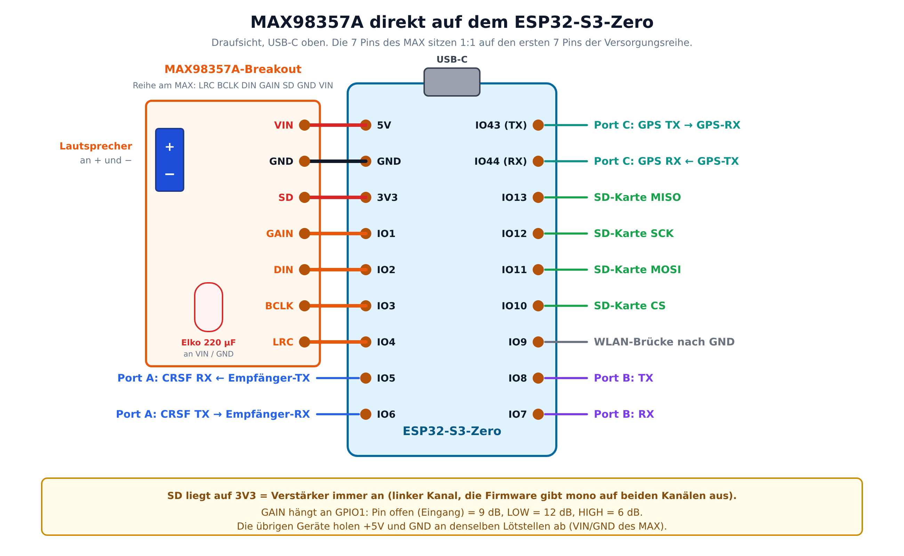
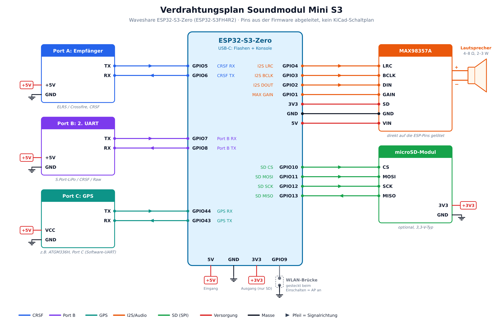

# Soundmodul Mini (S3)

Kompaktes Soundmodul für Motorgeräusche und Effekte auf Basis ESP32-S3-Zero (ESP32-S3FH4R2, 4 MB Flash, 2 MB PSRAM).
Abgeleitet von [ESP32-RC-Sound V7](https://github.com/mnorden81/mnorden81-ESP32-Sound-bidirectional_code), reduziert auf:

- **Eingang:** nur CRSF (Port A), busbasiert
- **Sounds:** Motor (Start/Loop/Stopp) + 4 Zusatzsounds
- **Speicher:** Flash (LittleFS), SD-Karte optional
- **Ports:** Port A (CRSF), Port B (zweiter UART), Port C (GPS), alle als Hardware-UART
- **Web-UI:** Sound-Upload und OTA-Update per WLAN
- **Verstärker:** MAX98357A (I2S)

**Aktuelle Version:** noch keine (Grundgerüst)

Projektplan: siehe `docs/`.

## Flash-Aufteilung (4 MB)

2 × 1,25 MB Firmware (OTA) + ca. 1,3 MB Sounds (≈ 30 s bei 22,05 kHz, 16 Bit mono).

## Sounds

Dateinamen: `start.wav`, `loop.wav`, `shut.wav`, `sound1.wav` … `sound4.wav` (16 Bit PCM, 22,05 kHz mono empfohlen).

Einstellung **Sound-Speicher** (Web-UI → Einstellungen oder Lua-Menü → Einstellungen), wirkt nach Neustart:

- **Auto** (Standard): SD-Karte, wenn eine steckt, sonst Flash
- **Flash**: interner Speicher (LittleFS), keine SD-Karte nötig
- **SD**: nur SD-Karte

Sounds ins Flash bringen:

1. Web-UI: Tab „Motor“ bzw. „Sounds“ → WAV hochladen (geht in den aktiven Speicher)
2. USB: Dateien nach `firmware/data/` legen, dann `pio run -t uploadfs`

Konfigurations-Backups liegen immer auf der SD-Karte.

## Bauen

```bash
cd firmware
pio run                 # Firmware bauen
pio run -t upload       # flashen
pio run -t uploadfs     # Sounds aus firmware/data/ ins Flash
```

## Hardware

Bauplan mit Bauteilliste, Pinbelegung und Grafiken: [`docs/Hardware-Bauplan_Mini-S3.docx`](docs/Hardware-Bauplan_Mini-S3.docx).
Die Pins kommen aus `firmware/src/pins.h` (ein KiCad-Schaltplan fehlt noch).

Der MAX98357A wird direkt auf die Versorgungsreihe des S3-Zero gelötet (VIN-5V, GND-GND, SD-3V3).





| Funktion | GPIO |
|---|---|
| MAX98357A direkt auf 5V, GND, 3V3, IO1..IO4 | GAIN 1, DIN 2, BCLK 3, LRC 4 |
| Port A CRSF RX / TX | 5 / 6 |
| Port B RX / TX | 7 / 8 |
| WLAN-Brücke (nach GND) | 9 |
| SD CS / MOSI / SCK / MISO (optional) | 10 / 11 / 12 / 13 |
| Port C GPS RX / TX | 44 / 43 |

## Ordner

- `firmware/` PlatformIO-Projekt
- `hardware/` Schaltplan, PCB
- `docs/` Pinout, Changelog
- `backups/` funktionierende Stände (nur lokal, nicht im Repo)

## Lizenz

GPL-3.0, wie das Ursprungsprojekt (enthält Code von XTronical).
