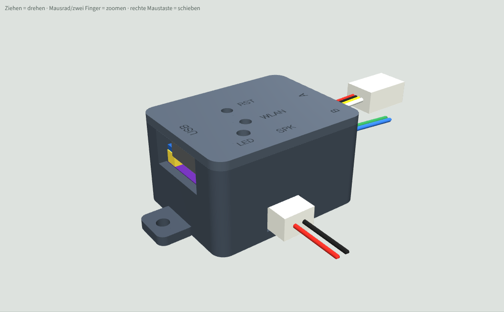
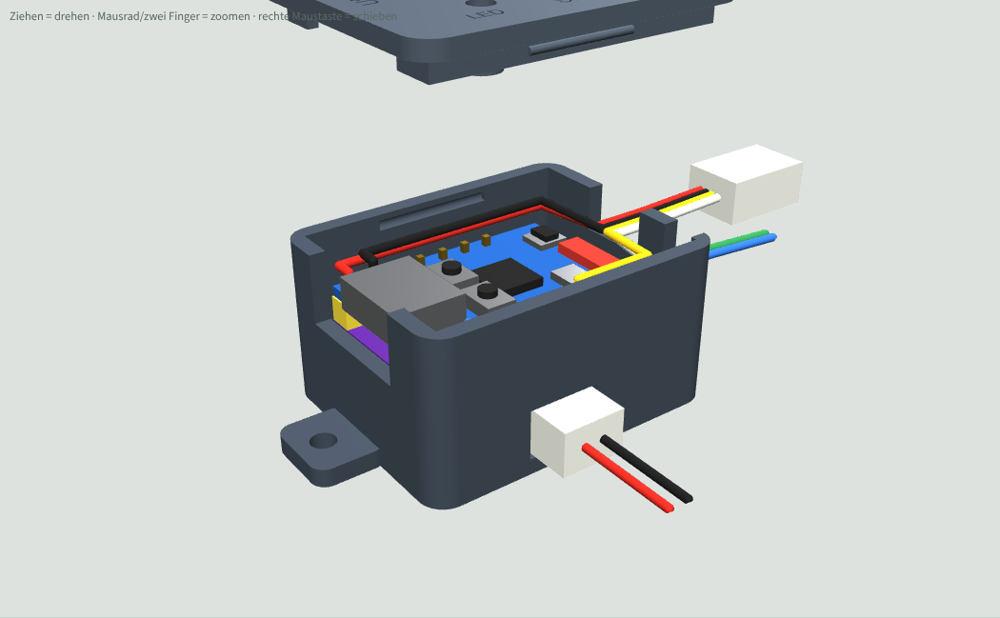

# Gehäuse für das ESP32 Sound Mini C3

3D-druckbares Gehäuse aus Unterteil und Deckel für den C3-Aufbau: ESP32-C3 Pro Mini mit dem **umgedrehten** MAX98357A auf der Versorgungsreihe (Bauteilseite des MAX zum ESP). Die Bauteilseite des ESP liegt oben, damit BOOT, RST und LED vom Deckel aus erreichbar sind. Gleiches Prinzip wie das [S3-Gehäuse](../gehaeuse/README.md).

| Zu | Deckel ab |
|---|---|
|  |  |

## Dateien
| Datei | Inhalt |
|---|---|
| `Gehaeuse_Unterteil.stl` | Unterteil, druckfertig (Boden aufs Bett) |
| `Gehaeuse_Deckel.stl` | Deckel, druckfertig (schon gedreht, Oberseite aufs Bett) |
| `Gehaeuse_Unterteil.step`, `Gehaeuse_Deckel.step` | zum Weiterbearbeiten in Fusion 360 oder FreeCAD (Deckel in Einbaulage) |
| `gehaeuse.py` | Quelle (CadQuery), alle Maße als Parameter oben in der Datei |
| `Gehaeuse3D_Vorschau.html` | drehbare 3D-Vorschau mit Modul (im Browser öffnen, braucht Internet für three.js) |

## Maße
- Außen 30,9 × 24,4 × 17,8 mm (mit Deckel, ohne Laschen).
- Wand, Boden und Deckel je 1,6 mm.

## Öffnungen
- Stirnseite USB: Kerbe für USB-C, oben offen, der Deckel schließt sie.
- Stirnseite Antenne: Kabelschlitz **A** (5V, GND, IO20, IO21 zum Empfänger) und Kabelschlitz **B** (IO5, IO6).
- Längsseite (IO-Reihe): Lautsprecher-Stecker JST-PH 2-polig, von außen einstecken.
- Deckel: Führungsrohre über BOOT (= WLAN-Taste) und RST, mit Zahnstocher oder Büroklammer drücken; Lichtrohr über der LED; vertiefte Beschriftung.

## Annahmen
- Maße des C3 Pro Mini aus dem Produktfoto: 23,4 × 17,8 mm, USB-C ragt 1,5 mm über. BOOT und RST ca. 8,9 mm von der USB-Kante, BOOT auf der Seite der IO-Reihe. LED-Lage geschätzt.
- MAX-Klon 17,8 × 19,3 mm, 2,5 mm Abstand (Kunststoff der Stiftleiste), JST-PH liegend auf der Außenseite des MAX.
- Der MAX deckt die Rückseite des ESP ab, deshalb sind alle Kabel (Port A und B) oben auf der Bauteilseite angelötet und laufen am Rand entlang zur Antennen-Stirnseite.

## Drucken und Montieren
- PLA oder PETG, 0,2 mm Schicht (für die Schrift 0,12 mm), keine Stützen nötig.
- Modul mit der ESP-Seite nach oben einlegen, USB-C in die Kerbe, Kabel in die Schlitze A und B legen, Deckel aufdrücken.
- Das Modul liegt auf zwei Stützen im Boden und wird von zwei Niederhaltern am Deckel (auf USB-Buchse und Keramikantenne) gehalten. Keine Schrauben, kein Kleber.
- Der Deckel klemmt mit einer Lippe und zwei Rastnasen. Sitzt er zu stramm, in `gehaeuse.py` `TOL` von 0,15 auf 0,2 erhöhen.
- Einbau ins Modell: 2 Laschen mit 2,4-mm-Loch (M2 oder Kabelbinder) oder doppelseitiges Klebeband.

## Ändern
Maße in `gehaeuse.py` anpassen und neu erzeugen (Python 3 mit `pip install cadquery`):
```
python gehaeuse.py .            # STL + STEP in diesen Ordner
python gehaeuse.py . --pruefen  # zusätzlich Kollisionsprüfung Modul gegen Gehäuse
```
